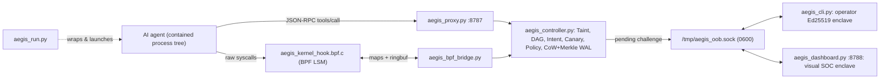

# AEGIS-ZERO

**Autonomous Execution Guard, Intent Sentinel & Zero-Trust Runtime Control Plane**: contains AI agents as untrusted, possibly Byzantine OS processes.

     

## Architecture



| Ring | Component | File | Description |
|---|---|---|---|
| 0 | Kernel Enforcers | `aegis_kernel_hook.bpf.c` | BPF LSM hooks: canary inodes, single-use `cap_tokens`, daemon self-protection |
| 0↔1 | Ring Bridge | `aegis_bpf_bridge.py` | bpf(2) map writer and ring-buffer consumer, with dry-run backend for macOS |
| 1 | Symbolic / Crypto | `aegis_controller.py`, `aegis_policy.cedar` | Taint lattice, inode-bound HMAC capabilities, CoW shadow store + Merkle WAL, Cedar lattice |
| 2 | Cognitive Sentinel | `aegis_controller.py` | Intent-Capability Taxonomy verifier (MiniLM if installed), DAG chains, EWMA drift, stego canonicalizer |
| OOB | L7 Proxy & CLI | `aegis_proxy.py`, `aegis_cli.py` | Hold-and-release proxy and operator console (Ed25519 asymmetric signing) |
| Enclave | Visual SOC Enclave | `aegis_dashboard.py` | Dark-mode web console on `:8788`, real-time SVG execution DAG, Merkle WAL inspector, approve/deny/rollback |
| Runner | Universal Launcher | `aegis_run.py` | Wraps any AI agent command inside containment, managing sandbox, canaries, proxy, and SIGSTOP freezer |

### Phase 5 modules

| Module | Purpose |
|---|---|
| [`aegis_db_guard.py`](aegis_db_guard.py) | `AegisDBGuard`: wraps a `sqlite3` connection. Each write runs in `SAVEPOINT aegis_sp_<n>`; exceeding `max_rows` or a non-ALLOW verdict rolls the savepoint back and freezes the agent. `_aegis_canary_row` in SQL or results is a CANARY_TRIP. |
| [`aegis_swarm.py`](aegis_swarm.py) | `SwarmCoordinator`: one controller per agent, grants attenuated to `Grants(U0) ∩ Grants(sub_intent)`. `relay_message` canonicalises messages (stego → freeze sender) and propagates taint `τ_to ⊔ τ_from` plus lineage. |
| [`aegis_forensics.py`](aegis_forensics.py) | `ForensicExporter`: Ed25519-signed canonical JSON incident bundles (state, decision, full WAL chain, OWASP LLM01/LLM06 + NIST AI RMF tags). `verify_bundle` checks the signature, every WAL link from genesis, and the Merkle root. CLI: `--verify bundle.json`. |

### Phase 6: MCP stdio, live pipeline wiring, benchmark

**Native MCP stdio proxy** — wrap any stdio MCP server for Claude Desktop / Cursor / Cline:
```bash
python3 aegis_mcp_stdio.py --intent "summarize report.md and write summary.md" --workdir ./sandbox \
        -- npx -y @modelcontextprotocol/server-filesystem ./sandbox
```
Example client config (`mcpServers` entry): `"command": "python3", "args": ["/path/aegis_mcp_stdio.py", "--intent", "...", "--", "<server cmd>", "..."]`.
Every `tools/call` is evaluated; blocked calls freeze the server tree, raise an OOB challenge (approve from `aegis_cli.py` or `aegis_dashboard.py`) and return JSON-RPC error `-32001`. Logs go to stderr only, so stdout framing is never corrupted.

**Live pipeline wiring (`aegis_proxy.py`)**:
- `sql_query` / `sql_exec` run inside an `AegisDBGuard` sandbox DB (`--db-path`, default in-memory, honey row installed); the signed `rollback` command also calls `rollback_all()`.
- `send_to_agent` is relayed through `SwarmCoordinator.relay_message()` (taint + lineage inheritance).
- Every `DENY` / `CANARY_TRIP` auto-exports a signed incident bundle to `/tmp/aegis_forensics_<uid>/` (`--keep-forensics` to retain); the path is in the OOB `pending` message as `forensic_bundle`. Bundles are signed with a per-session **proxy attestation key** (`proxy.forensic_pub`), never the operator key, so Ring 1 still holds no operator secret.

**Benchmark** — `python3 -B aegis_benchmark.py --write-doc` regenerates [BENCHMARK.md](BENCHMARK.md) (TPR/FPR and P50/P95/P99 per component).

### Phase 7: Non-Euclidean & Topological Security Engine ([`aegis_hypermath.py`](aegis_hypermath.py))

Pure-stdlib (`math`, `cmath`, `hashlib`) geometric & cohomological primitives fused into `AegisController.evaluate()`'s `risk` telemetry (`d_poincare`, `sheaf_energy`, `tropical_cost`, `padic_dist`):

| Primitive | Mathematical Formulation | Security Function |
|---|---|---|
| `PoincarePrivilegeManifold` | Open Poincaré ball $\mathbb{B}^n_c$, Möbius addition $u \oplus_c v$, geodesic $d_{\mathbb{B}}(u,v) = \frac{2}{\sqrt{c}}\operatorname{arctanh}(\sqrt{c}\|(-u)\oplus_c v\|)$ | Privilege tiers scale radius $r \in [0.05, 0.98]$ monotonically toward boundary $1/\sqrt{c}$, causing exponential geodesic divergence toward `EXEC` / `CREDENTIAL` |
| `CellularSheafObserver` | Cellular sheaf $(\mathcal{G}, \mathcal{F})$ with linear restriction maps $\mathcal{F}_{u\unlhd e}$ and Dirichlet energy $\mathcal{E}_{\text{sheaf}}(s) = \sum_e \|\mathcal{F}_{u\unlhd e}(s_u) - \mathcal{F}_{v\unlhd e}(s_v)\|_2^2$ | Detects semantic and provenance contradictions across multi-step traces and multi-agent claims ($H^1(\mathcal{G},\mathcal{F}) \neq 0$) |
| `TropicalGeodesicEngine` | Min-plus semiring $(A \otimes B)_{ij} = \min_m (A_{im} + B_{mj})$, $k$-step horizon $W^{\otimes k}$ | Preemptively flags multi-hop staging setups (`READ_SENSITIVE -> TRANSFORM`) *before* `NET_OUT` or `CANARY_SINK` executes |
| `PAdicUltrametricGuard` | Non-Archimedean $p$-adic ultrametric $d_p(x,y) = p^{-v_p(x,y)}$ satisfying $d_p(x,z) \le \max(d_p(x,y), d_p(y,z))$ | Isolates workspace clopen balls from canary decoys, OS root paths, and external URI namespaces |

**Phase 8 SOC Topology UI ([`aegis_dashboard.py`](aegis_dashboard.py)):** Renders an interactive HTML5 `<canvas>` Poincaré Privilege Disk (with $r = 0.92$ event horizon and curved Bezier geodesic arcs from $U_0$) alongside live Cellular Sheaf $\mathcal{E}_{\text{sheaf}}$ sparkline, Tropical $W^{\otimes k}$ horizon, and $p$-adic clopen ball telemetry cards.

The full formal model, threat matrix and protocol specs are in [ARCHITECTURE.md](ARCHITECTURE.md).

## Quickstart

### Installation
AEGIS-ZERO has **zero mandatory runtime dependencies** beyond the Python standard library. Optional dependencies enable constant-time Ed25519 (`cryptography`) and neural embeddings (`sentence-transformers`):

```bash
git clone https://github.com/aegis-zero/aegis-zero.git
cd aegis-zero
pip install -e .
```

### 1. Universal Agent Containment (`aegis_run.py`)
Wrap any autonomous agent command inside runtime containment:

```bash
# Wrap an agent command with root intent specification
python3 aegis_run.py --intent "summarize report.md and write summary.md" -- python3 my_agent.py

# With the visual SOC dashboard running simultaneously:
python3 aegis_dashboard.py --socket /tmp/aegis_oob.sock
```

### 2. Manual Operator Console & L7 Proxy
```bash
# Initialize operator keypair (~/.aegis/operator_ed25519.{key,pub})
python3 aegis_cli.py --init-key

# Start the reverse proxy
python3 aegis_proxy.py --intent "summarize report.md and write summary.md" \
        --agent-pid <PID> --upstream http://127.0.0.1:9000/ --workdir ./sandbox

# Connect operator console
python3 aegis_cli.py
# Commands: list | show <id> | approve <id> | deny <id> [--kill] | rollback | status
```

### 3. Live 3-Terminal SOC Radar & Red-Team Demo (`aegis_live_demo.py`)
```bash
# Terminal 1: Start L7 Proxy + OOB Unix Socket
python3 aegis_proxy.py --intent "summarize report.md and write summary.md, using the knowledge base for context" \
        --upstream http://127.0.0.1:9000/ --workdir ./sandbox --hold-timeout 45

# Terminal 2: Start Dark-Mode SOC Web Dashboard (http://127.0.0.1:8788)
python3 aegis_dashboard.py

# Terminal 3: Fire paced benign & adversarial tool calls to watch the Poincare disk & Sheaf sparkline react live
python3 aegis_live_demo.py
```

### 4. Linux Kernel Enforcement (BPF LSM)
```bash
make lima-up        # Ubuntu 24.04 VM, kernel 6.8, lsm=...,bpf (from macOS)
make lima-verify    # vmlinux.h -> clang -target bpf -> verifier load + autoattach -> bridge test
# On native Linux:
make vmlinux build-bpf verify-bpf
sudo python3 aegis_bpf_bridge.py --run --intent "..." --cgroup /sys/fs/cgroup/aegis_sandbox
```

## Verification (`make verify-darwin`)

Running `make verify-darwin` executes the complete verification suite spanning 12 modules and 77 assertions, followed by a strict zero-leftover-artifacts workspace audit:

| Suite | Target | Tests | Assertions / Verifications | Result |
|---|---|---|---|---|
| **Controller** | `test-controller` | 10 | K0 Ed25519 RFC 8032 KAT, T0 real SIGSTOP tree freeze, S1 TOCTOU symlink swap, S2 poisoned RAG exfil chain, S3 canary trip, S4 stego canonicalizer, S5 benign workflow, S6 CoW Merkle WAL & rollback, K1 proxy-heap memory dump forgery resistance, Intent calibration | 10/10 PASS |
| **L7 Proxy** | `test-proxy` | 11 | E1–E10 over live HTTP and Unix socket: hold, approve, deny, kill, fail-closed timeout, live signed rollback; E11 SQL honey row through the live proxy → trip + verified forensic bundle | 11/11 PASS |
| **BPF Bridge** | `test-bridge` | 10 | B1 C struct layouts, B2 enums, B3 `dev_t` encoding, B4 ringbuf wrap/discard/busy, B5 map bytes, B6 event → freeze + challenge, B7 live maps | 10/10 PASS |
| **SOC Dashboard** | `test-dashboard` | 5 | D1 HTML5 SOC UI delivery, D2 JSON telemetry stream, D3 signed approve via API, D4 signed deny of frozen egress (403), D5 transactional rollback via API | 5/5 PASS |
| **Universal Runner** | `test-runner` | 4 | R1 aligned read+write (200), R2 taint propagation, R3 real SIGSTOP freeze + signed rollback + deny, R4 agent verifies pre-session state restored, exits 0 | 4/4 PASS |
| **DB Guard** | `test-dbguard` | 3 | DB1 aligned SELECT + 1-row UPDATE, DB2 mass UPDATE → `ROLLBACK TO SAVEPOINT` + freeze (0 rows changed), DB3 honey-row SELECT → CANARY_TRIP + freeze | 3/3 PASS |
| **Swarm** | `test-swarm` | 3 | SW1 taint A→B then B's write escalates + freezes, SW2 `Grants(U0) ∩ Grants(sub)` blocks delegated `http_post` (D > 0.75), SW3 stego inter-agent message freezes sender | 3/3 PASS |
| **Forensics** | `test-forensics` | 5 | F1 write + canary trip, F2 signed bundle verifies, F3 1-char tamper rejected, F4 re-signed WAL forgery rejected, F5 wrong key rejected | 5/5 PASS |
| **MCP stdio** | `test-mcp` | 6 | M1 initialize/tools/list pass-through, M2 aligned `read_file`, M3 `rag_search` taints, M4 tainted `write_file` → `-32001` + server `SIGSTOP`, M5 framing intact + thaw, M6 clean EOF exit | 6/6 PASS |
| **Benchmark** | `test-benchmark` | 1 | 16 cases (6 benign, 10 adversarial), asserts TPR = 100% and FPR = 0% — see [BENCHMARK.md](BENCHMARK.md) | 1/1 PASS |
| **HyperMath** | `test-hypermath` | 5 | H1 Poincaré boundary divergence, H2 Cellular Sheaf Dirichlet energy & $H^1$ obstruction, H3 Tropical $W^{\otimes 3}$ preemptive 2-step setup alert, H4 $p$-adic Strong Triangle Inequality (680 triples) & clopen balls, H5 `AegisController.evaluate()` fusion | 5/5 PASS |
| **Live Demo** | `test-livedemo` | 4 | L1 aligned steps + signed declassification, L2 exfil chain held & denied (403), L3 live Poincaré / Sheaf / Tropical / $p$-adic telemetry over `/api/state`, L4 dashboard event history | 4/4 PASS |

**Total: 77/77 PASS, 0 workspace artifacts.**

Intent calibration: aligned actions score $D_{cos} \le 0.220$ and unaligned actions score $D_{cos} \ge 0.990$.

## OWASP Top 10 for Agentic Applications (2026) Compliance Matrix

| OWASP Agentic ID | Risk Category (2026) | AEGIS-ZERO In-Path Enforcement Control |
|---|---|---|
| **ASI01** | Agent Goal Hijack | Context-isolated `IntentVerifier` (sees only $U_0$ and $\text{AST}(A_t)$, never $D_{\text{ext}}$) + Poincaré geodesic boundary |
| **ASI02** | Tool Misuse & Exploitation | Capability taxonomy gate + single-use HMAC-SHA256 `(dev, ino)` capability tokens (`PolicyEngine` + `BPF_LSM`) |
| **ASI03** | Identity & Privilege Abuse | Non-Archimedean $p$-adic clopen filesystem isolation + sub-agent privilege attenuation ($\text{Grants}(U_0) \cap \text{Grants}(U_B)$) |
| **ASI04** | Agentic Supply Chain Vulnerabilities | Native stdio MCP proxy (`aegis_mcp_stdio.py`) + canary tripwire files & SQL honey-rows (`_aegis_canary_row`) |
| **ASI05** | Unexpected Code Execution (RCE) | Ring 0 `bprm_check_security` LSM hook + seccomp syscall filter + atomic cgroups v2 / `SIGSTOP` process freezing |
| **ASI06** | Memory & Context Poisoning | Monotone Biba/BLP `TaintEngine` ($\tau \to \text{TAINTED}$ on `rag_search` / `fetch_url`) + CoW Merkle WAL & SQL `SAVEPOINT` rollback |
| **ASI07** | Insecure Inter-Agent Communication | `SwarmCoordinator` cross-agent taint inheritance + `Canonicalizer` stego scrubber + Cellular Sheaf cohomology ($H^1$) |
| **ASI08** | Cascading Failures | Fail-closed hold-and-release queue (`--on-timeout kill`) + multi-agent taint circuit breakers |
| **ASI09** | Human-Agent Trust Exploitation | Out-of-Band Web Enclave (`aegis_dashboard.py`) & `0600` Unix socket (`aegis_cli.py`) displaying raw AST + blast radius with Ed25519 signatures |
| **ASI10** | Rogue Agents | EWMA slow-drift accumulator + Tropical semiring $W^{\otimes k}$ exploit horizon + `task_kill` daemon self-protection |

## Security Notes
- **Enclave Asymmetry**: The proxy, bridge, and dashboard load **only** `operator_ed25519.pub`. Dumping daemon memory yields zero private keys; signature forgery is cryptographically impossible under RFC 8032 (verified by test K1).
- **Pure-Python Fallback**: If `cryptography` is not installed, a stdlib pure-Python Ed25519 engine executes. It is automatically upgraded when `cryptography` is present.
- **Fail-Closed Guarantee**: Held actions time out after 120s (configurable) and automatically default to deny and SIGKILL.
- **Formal Verification**: `aegis_policy.cedar` models the multi-tier lattice in Cedar; `PolicyEngine` provides the verified runtime implementation.
