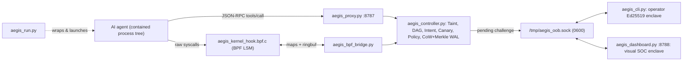

# AEGIS-ZERO

**Autonomous Execution Guard, Intent Sentinel & Zero-Trust Runtime Control Plane**: contains AI agents as untrusted, possibly Byzantine OS processes.

     

## Architecture



| Ring | Component | File | Description |
|---|---|---|---|
| 0 | Kernel Enforcers | `aegis_kernel_hook.bpf.c` | BPF LSM hooks: canary inodes, single-use `cap_tokens`, daemon self-protection |
| 0↔1 | Ring Bridge | `aegis_bpf_bridge.py` | bpf(2) map writer and ring-buffer consumer, with dry-run backend for macOS |
| 1 | Symbolic / Crypto | `aegis_controller.py`, `aegis_policy.cedar` | Taint lattice, inode-bound HMAC capabilities, CoW shadow store + Merkle WAL, Cedar lattice |
| 2 | Cognitive Sentinel | `aegis_controller.py` | Intent-Capability Taxonomy verifier (MiniLM if installed), DAG chains, EWMA drift, stego canonicalizer |
| OOB | L7 Proxy & CLI | `aegis_proxy.py`, `aegis_cli.py` | Hold-and-release proxy and operator console (Ed25519 asymmetric signing) |
| Enclave | Visual SOC Enclave | `aegis_dashboard.py` | Dark-mode web console on `:8788`, real-time SVG execution DAG, Merkle WAL inspector, approve/deny/rollback |
| Runner | Universal Launcher | `aegis_run.py` | Wraps any AI agent command inside containment, managing sandbox, canaries, proxy, and SIGSTOP freezer |

The full formal model, threat matrix and protocol specs are in [ARCHITECTURE.md](ARCHITECTURE.md).

## Quickstart

### Installation
AEGIS-ZERO has **zero mandatory runtime dependencies** beyond the Python standard library. Optional dependencies enable constant-time Ed25519 (`cryptography`) and neural embeddings (`sentence-transformers`):

```bash
git clone https://github.com/aegis-zero/aegis-zero.git
cd aegis-zero
pip install -e .
```

### 1. Universal Agent Containment (`aegis_run.py`)
Wrap any autonomous agent command inside runtime containment:

```bash
# Wrap an agent command with root intent specification
python3 aegis_run.py --intent "summarize report.md and write summary.md" -- python3 my_agent.py

# With the visual SOC dashboard running simultaneously:
python3 aegis_dashboard.py --socket /tmp/aegis_oob.sock
```

### 2. Manual Operator Console & L7 Proxy
```bash
# Initialize operator keypair (~/.aegis/operator_ed25519.{key,pub})
python3 aegis_cli.py --init-key

# Start the reverse proxy
python3 aegis_proxy.py --intent "summarize report.md and write summary.md" \
        --agent-pid <PID> --upstream http://127.0.0.1:9000/ --workdir ./sandbox

# Connect operator console
python3 aegis_cli.py
# Commands: list | show <id> | approve <id> | deny <id> [--kill] | rollback | status
```

### 3. Linux Kernel Enforcement (BPF LSM)
```bash
make lima-up        # Ubuntu 24.04 VM, kernel 6.8, lsm=...,bpf (from macOS)
make lima-verify    # vmlinux.h -> clang -target bpf -> verifier load + autoattach -> bridge test
# On native Linux:
make vmlinux build-bpf verify-bpf
sudo python3 aegis_bpf_bridge.py --run --intent "..." --cgroup /sys/fs/cgroup/aegis_sandbox
```

## Verification (`make verify-darwin`)

Running `make verify-darwin` executes the complete verification suite spanning 5 modules and 38 assertions, followed by a strict zero-leftover-artifacts workspace audit:

| Suite | Target | Tests | Assertions / Verifications | Result |
|---|---|---|---|---|
| **Controller** | `test-controller` | 10 | K0 Ed25519 RFC 8032 KAT, T0 real SIGSTOP tree freeze, S1 TOCTOU symlink swap, S2 poisoned RAG exfil chain, S3 canary trip, S4 stego canonicalizer, S5 benign workflow, S6 CoW Merkle WAL & rollback, K1 proxy-heap memory dump forgery resistance, Intent calibration | 10/10 PASS |
| **L7 Proxy** | `test-proxy` | 10 | E1–E10 over live HTTP and Unix socket: hold, approve, deny, kill, fail-closed timeout, live signed rollback | 10/10 PASS |
| **BPF Bridge** | `test-bridge` | 10 | B1 C struct layouts, B2 enums, B3 `dev_t` encoding, B4 ringbuf wrap/discard/busy, B5 map bytes, B6 event → freeze + challenge, B7 live maps | 10/10 PASS |
| **SOC Dashboard** | `test-dashboard` | 4 | D1 HTML5 SOC UI delivery, D2 JSON telemetry stream, D3 hold-and-release decision via API, D4 transactional rollback via API | 4/4 PASS |
| **Universal Runner** | `test-runner` | 4 | R1 Aligned tool execution, R2 Taint propagation, R3 Dynamic freezing + operator deny, R4 Clean agent exit | 4/4 PASS |

**Total: 38/38 PASS, 0 workspace artifacts.**

Intent calibration: aligned actions score $D_{cos} \le 0.220$ and unaligned actions score $D_{cos} \ge 0.990$.

## Security Notes
- **Enclave Asymmetry**: The proxy, bridge, and dashboard load **only** `operator_ed25519.pub`. Dumping daemon memory yields zero private keys; signature forgery is cryptographically impossible under RFC 8032 (verified by test K1).
- **Pure-Python Fallback**: If `cryptography` is not installed, a stdlib pure-Python Ed25519 engine executes. It is automatically upgraded when `cryptography` is present.
- **Fail-Closed Guarantee**: Held actions time out after 120s (configurable) and automatically default to deny and SIGKILL.
- **Formal Verification**: `aegis_policy.cedar` models the multi-tier lattice in Cedar; `PolicyEngine` provides the verified runtime implementation.
